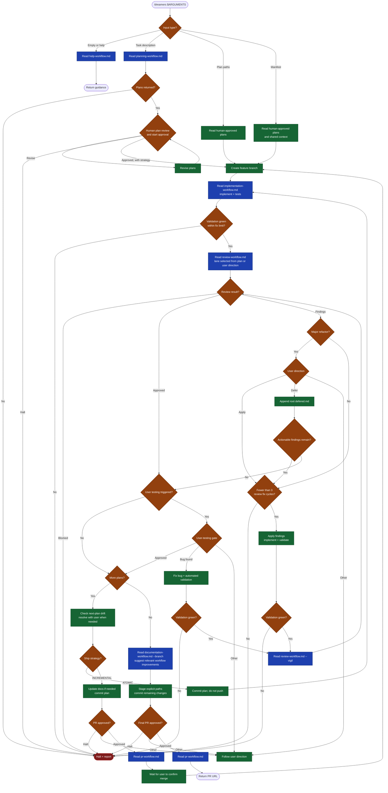

# Dreamers — GitHub Copilot CLI

An agent orchestration system for GitHub Copilot CLI. Runs the planning → implementation + tests → selected review → Vigil follow-up review → docs → PR flow.

Invoke any skill from Copilot CLI: `/dreamers <task>`, `/dreamers-help`, `/dreamers-plan <task>`, `/dreamers-lite <task>`, etc. Use `/dreamers help` or `/dreamers-help` for read-only orientation.

## Layout

```
.github/
├── agents/       # Agent definitions
├── skills/       # Skill entry points (/dreamers and /dreamers-*)
├── dreamers/
│   ├── refs/     # Shared workflows and standards
│   └── templates/# Plan, manifest, PR description, logging standards, etc.
└── instructions/ # Auto-loaded instruction files (Copilot CLI picks these up)
```

## Agents

| Agent | Type | Role |
|---|---|---|
| **Sentinel** | Subagent | Reviewer — correctness, security, maintainability. Read-only except one `.dreamers/reviews/` artifact. |
| **Probe** | Subagent | Reviewer — test coverage (AC matrix, layer audit, edge + negative cases, regression risk). Read-only except one `.dreamers/reviews/` artifact. |
| **Hone** | Subagent | Reviewer — over-engineering, redundancy, bad architecture. Read-only except one `.dreamers/reviews/` artifact; surfaces full-refactor recommendations without softening. |
| **Vigil** | Subagent | Single-pass reviewer for lite plans, skill-internal reviews outside `/dreamers` and `/dreamers-review`, and `/dreamers` follow-up reruns. Reviews correctness, security, maintainability, test coverage, and simplicity; writes one `.dreamers/reviews/` artifact with a required architecture audit section. |
| **Echo** | Subagent | Documentarian — README, CHANGELOG, Echo-owned sections of `copilot-instructions.md`. Stages edits; never commits. |

Vigil, Sentinel, Probe, and Hone spawn through the shared `review-workflow.md` and each write a durable review artifact. The workflow selects Vigil for lite plans, Sentinel + Probe for standard plans, and Sentinel + Probe + Hone for complex plans unless the plan or user explicitly directs another lane. Without a plan, it infers the intended behavior from the user context, branch/PR metadata, diff, tests, and nearby code; if that evidence is ambiguous, it asks one concise question before reviewing. `/dreamers` applies findings and owns follow-up review, user-testing, and fix loops. Echo spawns per milestone through `documentation-workflow.md`. Standalone `/dreamers-review` and `/dreamers-docs` read those same refs.

## Skills

Every skill is an independent entry point. Shared behavior lives in workflow refs, which skills read and execute directly; skills never invoke other skills or load another skill's `SKILL.md`. Explicit user instructions can skip or alter phases/actions.

Across Dreamers skills, an explicit user choice to defer a suggested change appends a structured entry to project-root `defered.md` without overwriting prior entries.

### Pipeline

| Skill | Purpose |
|---|---|
| `/dreamers <task | plan paths | manifest>` | End-to-end pipeline: task mode reads `planning-workflow.md`, then the implementation-start gate; plan path and manifest modes skip both using human-approved input. Per plan it executes the implementation and review refs; the orchestrator applies findings, records deferred findings in project-root `defered.md`, and preserves the original testing, close-out, approval, and PR gates. |
| `/dreamers-help` | Read-only orientation, examples, reviewer lanes, gates, specialized choices, and migration guidance. Empty or help-like `/dreamers` input reads the same help ref before repository or external inspection. |
| `/dreamers-plan <task>` | 3-phase planning (Hash-out → Write → Review). Stores every Grill question and response word for word in a transcript linked from each plan, produces plans with Goal, Scope and context, and Acceptance Criteria, plus an optional manifest, verifies coverage, then hard-stops at approval. |
| `/dreamers-implement <task or plan>` | One cycle against a task or approved plan: implementation + tests → type-check + test run. Exits at green tests; `/dreamers` reads the review ref next. |
| `/dreamers-review` | Selects reviewers from plan complexity or explicit plan/user direction and supplies a linked or sibling verbatim Grill transcript to reviewers when present. Without a plan it infers intent from code and context, asking if unclear. Read-only. |
| `/dreamers-docs` | Spawns Echo to update project docs from the diff. `--branch` or `--staged` scope. |
| `/dreamers-pr` | Pushes the branch, drafts the PR body from the template, opens the PR via `gh`. |
| `/dreamers-lite <task>` | Task delivery without planning: implement + test, Vigil review (up to 2 fix cycles), docs from the uncommitted diff, commit, then PR approval. Halt on blocked review or unresolved findings at the cap. |
| `/dreamers-find-refactors [scope or directive]` | Refactor discovery: select lenses, section the repo, run section-scoped Hone audits, synthesize findings, write Dreamers plan files, then stop. No implementation or PR. |

### Standalone reviewer audits

| Skill | Purpose |
|---|---|
| `/dreamers-test` | Focused Vigil audit — test coverage findings on the current diff. |
| `/dreamers-simplify` | Focused Vigil audit — over-engineering and architectural findings. |

### Utility

| Skill | Purpose |
|---|---|
| `/dreamers-pr-resolve [#PR]` | Resolve unresolved PR review comments. Apply accepted fixes inline; Vigil reviews accepted changes before thread resolution, and deferred Vigil findings are appended to project-root `defered.md`. |
| `/dreamers-explain <question, topic, path, code, or URL>` | Thorough, read-only explanation with layered mental models, concrete examples, local evidence, and authoritative sources when needed. |
| `/dreamers-issue <task>` | Create a structured GitHub issue with acceptance criteria. Prefix with `#` for discussion mode. |
| `/dreamers-new-project` | Bootstrap a new project: discovery → optional existing-solutions research → stack → brief → shell plans. |
| `/dreamers-cleanup-comments` | Project-wide comment cleanup per `comment-rules.md`. Audit → approve → apply. |
| `/dreamers-cleanup-comments-branch` | Same cleanup, scoped to the current feature-branch diff. |
| `/dreamers-add-logging` | Phased pass to add/improve logging per `logging-standards.md`. |
| `/dreamers-clean-work` | Between-milestone maintenance: audit improvements, inspect legacy workspace files, scan for drift. |
| `/dreamers-plan-verify <plan>` | Inline drift check: cited paths / signatures / data shapes still hold? |

## Delivery

`/dreamers`: plan and approve task input, or use supplied human-approved plans; implement and test, review, then complete triggered user testing, docs, commit, and PR approval. Review fixes use Vigil, with at most 3 fix cycles. A blocked review or unresolved findings at the cap stops delivery.

`/dreamers-lite`: supply a task directly; implement and test, review with Vigil, update docs using `--staged`, commit, and request PR approval. At most 2 review fix cycles; the same stop conditions apply. Major refactors require user direction in either workflow.

Both delivery skills resume after conversational detours and keep one todo aligned with confirmed results. Related bug reports authorize fixes unless the user requests discussion or says otherwise. Corrections to an open PR repeat implementation, review, and the docs check before requesting approval to commit and push the update. Short standalone helper skills have optional todos.

## `/dreamers` first delivery example


