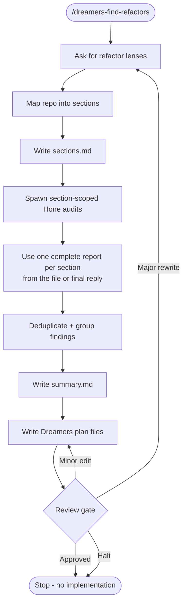

# dreamers-find-refactors - flow

Source of truth is `SKILL.md`.

## Invariants

- Read-only for project code.
- Hone attempts to save section-named reports under `.dreamers/reviews/` and returns the same reports in its final replies. The synthesis records missing handoffs, blockers, and open questions.
- The orchestrator groups findings into the smallest coherent shippable plans, with a manifest when there are multiple plans.
- Generated plans use the shared Goal and Acceptance criteria format.
- No branch, implementation, commit, push, or PR.
