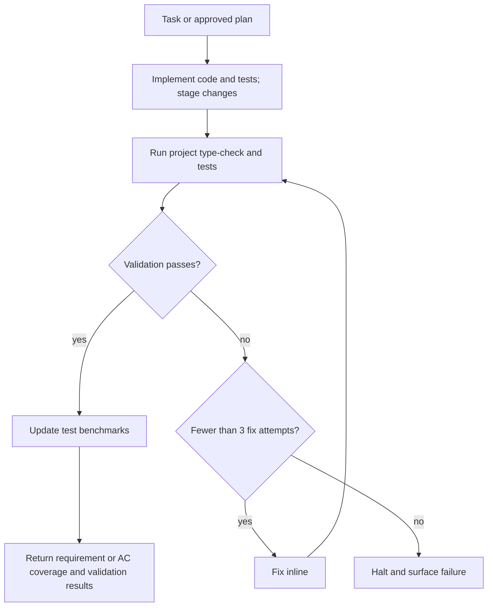

# /dreamers-implement — flow

One task or approved plan, implemented inline. Source of truth is `SKILL.md`.

- Tasks use their stated requirements as acceptance criteria, without a plan file. Plans use their annotated AC layers; tests-first ordering is not required.
- Standalone todos are optional. Calls from a delivery skill use its existing todo.
- The skill exits at green validation. `/dreamers` invokes `/dreamers-review` next.
