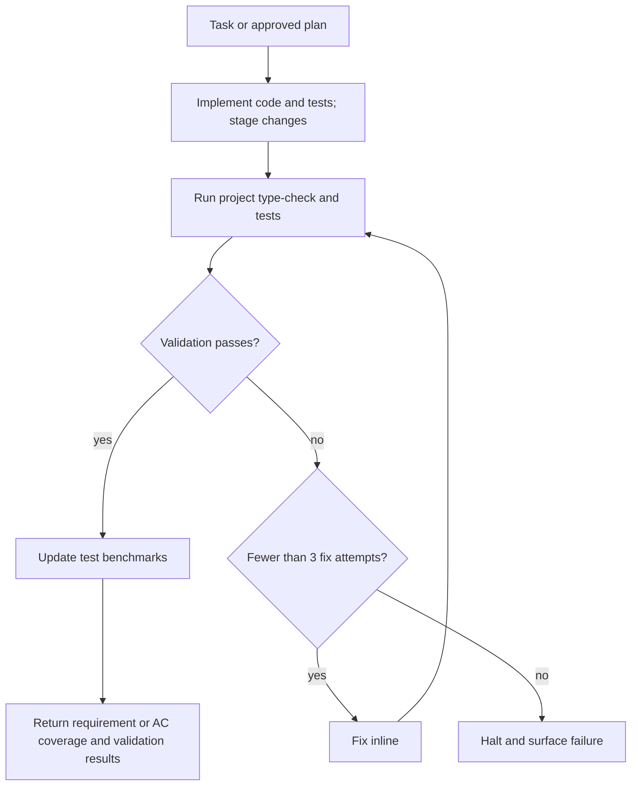

# /dreamers-implement — flow

One task or approved plan, implemented inline. Shared workflow: [implementation-workflow](../../dreamers/refs/implementation-workflow.md). `SKILL.md` embeds this ref and its required standards through XML sync.

- Tasks use their stated requirements as acceptance criteria, without a plan file. Plans use their annotated AC layers; tests-first ordering is not required.
- Standalone todos are optional. Delivery skills execute the same embedded workflow under their existing todo.
- The skill exits at green validation. `/dreamers` executes its embedded review workflow next.
