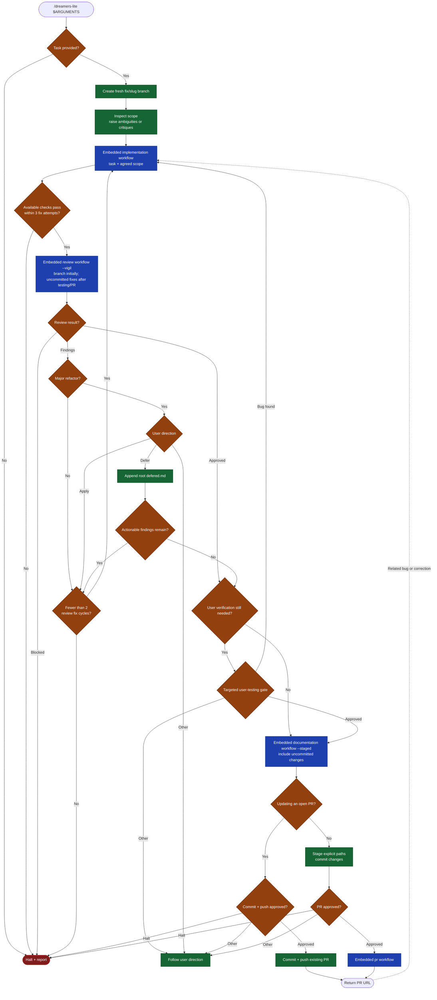

# /dreamers-lite

Deliver a task without creating a plan. Delivery order: `SKILL.md`. Shared phase mechanics: XML-synced workflow blocks embedded in this skill, with all required standards. No skill calls or runtime ref-file reads.

The Required workflow checklist drives setup, the implementation/test/review loop, conditional user testing, docs, and close-out. Implementation, review, documentation, and publishing bodies sit directly in their corresponding sections. This skill supplies their inputs and owns the todo, review loop, approval, and final exit. Shared rules and formats are grouped once at the end.

1. Create a fresh `fix/<slug>` branch. Inspect the task and raise ambiguities or critiques.
2. Pass the task and agreed scope to `implementation-workflow.md`; execute it inline to implement, type-check, and test.
3. Run `review-workflow.md` with `--vigil --branch` and the task context (no plan binding). Apply findings through at most 2 implementation/review fix cycles. Ask before major refactors and record deferred findings in `defered.md`. Halt on blocked review or unresolved findings at the cap.
4. Perform available automated and agent-operated verification. Ask the user only for remaining checks you cannot complete or explicit personal testing. Bugs return to step 1 of Implement and review loop, retaining the active cap.
5. Update docs with `documentation-workflow.md --staged`, which includes uncommitted changes. Commit explicit paths, present the summary for approval, then execute the embedded PR block and return its URL.

Questions leave the next phase pending; resume after answering unless the user requests discussion, pauses, or changes direction. Related bug reports resume the existing `Implement and review loop` at step 1; do not invoke the delivery skill again. For an open PR, reuse its branch and repeat implementation/tests, capped Vigil review, user testing only when needed, and docs; ask approval before committing and pushing the update.

Keep one delivery todo aligned with confirmed results, reopening affected stages after changes and reconciling stale entries after detours. New corrections after completed close-out start a new capped cycle; detours within a cycle keep its review count.

Implementation validation halts after 3 failed fix attempts. User instructions can override commit or PR steps.
