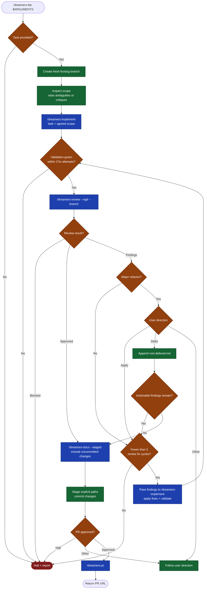

# /dreamers-lite

Deliver a task without creating a plan. Source of truth: `SKILL.md`.

1. Create a fresh `fix/<slug>` branch. Inspect the task and raise ambiguities or critiques.
2. Pass the task and agreed scope to `/dreamers-implement`; it implements, type-checks, and tests.
3. Run `/dreamers-review --vigil --branch <task>`. Apply findings through at most 2 implementation/review fix cycles. Ask before major refactors and record deferred findings in `defered.md`. Halt on blocked review or unresolved findings at the cap.
4. Update docs with `/dreamers-docs --staged`, which includes uncommitted changes. Commit explicit paths, present the summary for approval, then invoke `/dreamers-pr` and return its URL.

Implementation validation halts after 3 failed fix attempts. User instructions can override commit or PR steps.
