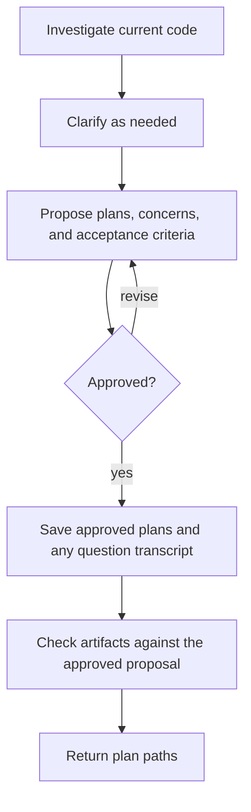

# /dreamers-plan — flow

Planning only. Source of truth is `SKILL.md`.

Every plan uses **Goal** and **Acceptance criteria**, matching GitHub issue proposals. Delivery metadata remains for downstream routing.

- Investigate code before proposing; report concerns with suggested acceptance criteria.
- Ask questions when needed and preserve any questions and answers verbatim in a linked transcript.
- Obtain proposal approval before writing; revisions require approval of the revised proposal.
- `Plan-type` labels lite / standard / complex for downstream reviewer selection.
- Split work only into independently shippable plans; use a manifest for their order and shared context.
- Planning formats are embedded through XML sync; no Dreamers rule-file reads are required.
- This skill returns paths to its caller or stops when standalone. It never implements or changes project files or git state.
