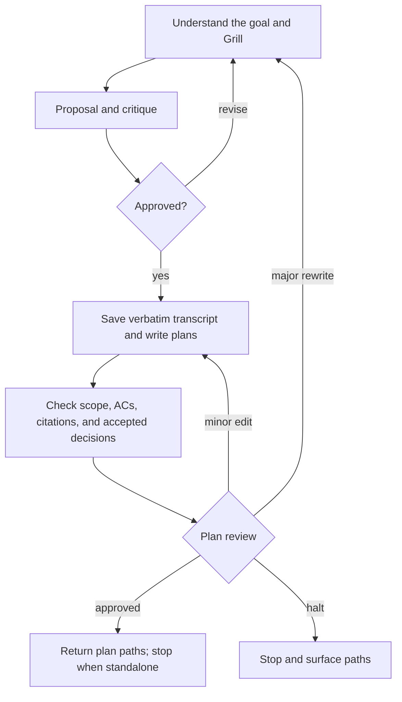

# /dreamers-plan — flow

Planning only. Shared workflow: [planning-workflow](../../dreamers/refs/planning-workflow.md). `SKILL.md` reads this ref directly.

Every plan uses **Goal**, **Scope and context**, and **Acceptance Criteria**. Keep relevant decisions, constraints, contracts, UI details, and risks within scope; include Mermaid flow diagrams or example UI layouts/wireframes when they clarify the change. Attach validation details to ACs when needed. There are no separate Approach or Verification sections.

- `Plan-type` still labels lite / standard / complex for reviewer selection; it does not select a document format.
- Grill one unresolved decision at a time. Save questions and responses verbatim and link the transcript from each plan when present.
- Proposal critique and plan approval remain mandatory. Written plans must preserve all accepted requirements and user decisions.
- Use a manifest for shared multi-plan context; backfill one when adding a second plan. Individual plans must remain usable alone.
- The workflow reads the Grill, plan-format, and manifest-format refs directly.
- Standalone planning owns its todo and stops at approval. When `/dreamers` reads the same ref, it keeps its delivery todo and implementation-start gate.
