# /dreamers-pr-resolve — flow

Visual map of the PR-feedback resolution skill. Source of truth is `SKILL.md`.

```mermaid
flowchart TD
    Start(["/dreamers-pr-resolve $ARGUMENTS"]) --> S1

    S1["Step 1 — Discover open PRs"] --> PRCheck{"PR target?"}
    PRCheck -->|$ARGUMENTS specified| UseSpecified["Use specified PR"]
    PRCheck -->|"Multiple open<br/>none specified"| PickPR["request_information<br/>list open PRs + Other"]
    PRCheck -->|Exactly one open| UseOne["Use it without prompting"]
    PickPR --> UseSpecified
    UseSpecified --> S2
    UseOne --> S2

    S2["Step 2 — Pull unresolved threads<br/>via GraphQL only"] --> Query["gh api graphql<br/>filter isResolved: false"]
    Query --> HasThreads{"Unresolved<br/>threads?"}
    HasThreads -->|None| EarlyExit(["Report + stop"])
    HasThreads -->|Yes| S3

    S3["Step 3. Check each request against the plan or issue"] --> ScopeCheck{"Out of scope?"}
    ScopeCheck -->|Yes| AskScope["Show comment and explain scope<br/>Ask Include in this PR or Decline"]
    AskScope --> PerThread["Track decisions by request<br/>Continue independent feedback"]
    ScopeCheck -->|No| PerThread
    PerThread --> AcceptedAny{"Any accepted fixes<br/>changed files?"}
    AcceptedAny -->|No| S6
    AcceptedAny -->|Yes| ApplyFixes["Apply accepted fixes<br/>inline + git add"]
    ApplyFixes --> S4

    S4["Step 4 — Type-check + run tests"] --> TestResult{"Tests pass<br/>within 3 attempts?"}
    TestResult -->|No| BlockedReplies["Step 7 — Reply-only mode<br/>blocked: reason for affected fixes<br/>no-action: reason for rejections<br/>leave threads open"]
    TestResult -->|Yes| S5

    S5["Step 5 — Vigil review"] --> SpawnVigil["Spawn Vigil"]
    SpawnVigil --> CollectReview["Accept a complete Vigil report<br/>from the file or final reply"]
    CollectReview --> ReviewResult{"Reviewer<br/>statuses?"}
    ReviewResult -->|Missing or blocked| BlockedReplies
    ReviewResult -->|Findings| ApplyReviewer["Apply or defer Vigil findings<br/>deferred → append root defered.md<br/>re-run tests after applied findings"]
    ReviewResult -->|Approved no findings| S6
    ApplyReviewer --> S6

    S6["Step 6 — Update docs and commit fixes"] --> NewCommit{"Changes<br/>to commit?"}
    NewCommit -->|No| S7
    NewCommit -->|Yes| Docs["/dreamers-docs"]
    Docs --> CommitFixes["git commit -m fix: address PR feedback"]
    CommitFixes --> PushGate{"Push gate"}
    PushGate -->|Hold| BlockedReplies
    PushGate -->|Push to PR| Push["git push"]
    PushGate -->|Other| PushGate
    Push --> PushResult{"Push succeeded?"}
    PushResult -->|Yes| S7
    PushResult -->|No| BlockedReplies
    BlockedReplies --> HaltA(["Report obstacle + stop<br/>retain local commit on Hold"])

    S7["Step 7. Reply when the outcome is decided<br/>fixed: in commit SHA<br/>blocked: reason<br/>no-action: reason"] --> ResolveGQL["Resolve only threads where<br/>every comment is fixed<br/>and every reply succeeded"]
    ResolveGQL --> S8

    S8["Step 8. Report"] --> PendingScope{"Scope decisions pending?"}
    PendingScope -->|Yes| ResumeScope["Wait for decision"] --> S3
    PendingScope -->|No| End(["fixed / blocked / no-action counts<br/>fixing SHAs or reasons + reply URLs<br/>commit hash + push status<br/>reviewer results + open threads"])

    classDef gate fill:#92400e,stroke:#78350f,stroke-width:2px,color:#fff
    classDef halt fill:#7f1d1d,stroke:#991b1b,stroke-width:2px,color:#fff
    classDef phase fill:#166534,stroke:#14532d,stroke-width:2px,color:#fff
    classDef agent fill:#7c3aed,stroke:#6d28d9,stroke-width:2px,color:#fff

    class PRCheck,HasThreads,ScopeCheck,AskScope,AcceptedAny,TestResult,ReviewResult,NewCommit,PushGate,PushResult,PendingScope,ResumeScope gate
    class HaltA halt
    class SpawnVigil agent
    class S1,S2,S3,S4,S5,S6,S7,S8,UseSpecified,PickPR,UseOne,Query,PerThread,ApplyFixes,CollectReview,ApplyReviewer,Docs,CommitFixes,Push,ResolveGQL,BlockedReplies phase
```

## Key invariants

- **GraphQL only** for unresolved-thread discovery. Paginate threads and comments; read the full discussion.
- **Scope comes first.** Acceptance-criterion and PR regression fixes are in scope even if the plan never named the file. Ask **Include in this PR** or **Decline** for out-of-scope requests. Wait before editing or replying on those requests and continue independent feedback. Included requests follow the accepted-fix workflow. Judge in-scope requests on their merits.
- **Reply after deciding the outcome.** Use `fixed: in commit <SHA>`, `blocked: <reason>`, or `no-action: <reason>`. Identify the source comment when replying to multiple comments in a thread and reuse identical replies on resume.
- **Fixed requires delivery.** Validate and review the fix, then reference its actual commit on the remote PR branch. Never claim an unpushed local fix is fixed.
- **Blocked covers declined scope expansions and fixes that could not be delivered.** For a declined request, reply `blocked: outside the scope of <plan or issue>` with a brief reason and leave the thread open. For an undelivered fix, state the obstacle before halting.
- **No-action means decided not to act.** State why; do not use it for an accepted issue that could not be fixed.
- **Only fully fixed threads resolve.** Every comment must be fixed and every reply successful. Blocked, no-action, and reply failures leave threads open.
- **Vigil is required for accepted fixes.** Use one Vigil pass with coverage, regression, or architectural risks in the prompt. Use one complete report, report a missing handoff or blocker, and raise open questions before applying findings.
- **Deferred Vigil findings persist.** Append them to project-root `defered.md` without overwriting prior entries; do not create follow-up plans automatically.
- **Push requires explicit approval.** Post-PR changes never auto-push.
- **Hold is a valid exit** — the commit stays on the branch for the user to push manually later.
