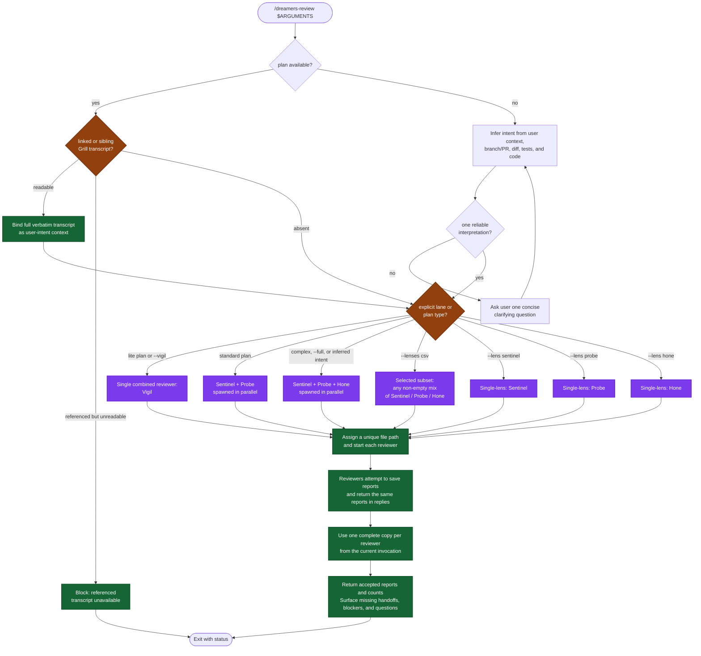

# /dreamers-review — flow

Visual map of the selected-lane review skill. Source of truth is `SKILL.md`. The caller applies fixes.

## Lens scope

| Lens | Reviewer | Returns |
|---|---|---|
| Combined correctness, security, maintainability, coverage, and simplicity | Vigil | Findings, intent alignment, requirement coverage, and architecture audit |
| Correctness / security / maintainability | Sentinel | Findings and intent-alignment summary |
| Test coverage (requirement matrix, layer audit, gaps) | Probe | Findings and requirement coverage table |
| Simplicity / over-engineering / architecture | Hone | Findings including full-refactor recommendations |

## Lane policy

| Lane | Reviewers | Normal use |
|---|---|---|
| vigil | Vigil | Lite plan or explicit request. |
| sentinel | Sentinel | Focused correctness, security, or maintainability audit. |
| probe | Probe | Focused test coverage or regression-risk audit. |
| hone | Hone | Focused architecture or simplicity audit. |
| standard | Sentinel + Probe | Standard plan or explicit combined correctness and coverage audit. |
| full | Sentinel + Probe + Hone | Complex plan, explicit full review, or standalone default. |

Selection precedence is explicit user direction or lane flag, then an explicit reviewer requirement in the plan, then `Plan-type`: lite → Vigil; standard → Sentinel + Probe; complex → Sentinel + Probe + Hone. Without a plan, it infers the intended behavior from user context, branch/PR metadata, the selected diff, tests, changed code, and nearby conventions; an ambiguous basis gets one user question before review. Inferred-intent reviews use the full triad unless the user chose a lane. This skill selects and runs the reviewers.

## Key invariants

- **Grill context follows the plan.** Resolve the plan's `**Grilling transcript:**` link, falling back to a sibling `grilling-transcript.md`; when readable, pass its full verbatim contents to every reviewer for intent alignment. A referenced but unreadable transcript blocks review.
- **`/dreamers` reruns.** Routine follow-up review reruns use `/dreamers-review --vigil`. A full or selected-lane rerun runs only when the major-change rerun gate asks the user and the user selects it.
- **No major-refactor gate here.** That logic lives in the caller. This skill just reports.
- **One report per reviewer.** Each reviewer gets a unique path under `.dreamers/reviews/`. Use the complete report at that path or the same invocation’s complete final reply. Report any missing handoff, blocker, or open question.
- **`--no-apply` doesn't exist** — this skill is always read-only by design.
- **Todo ownership is contextual.** Standalone todos are optional; when invoked by a delivery skill, review completes the phase under its existing todo.
