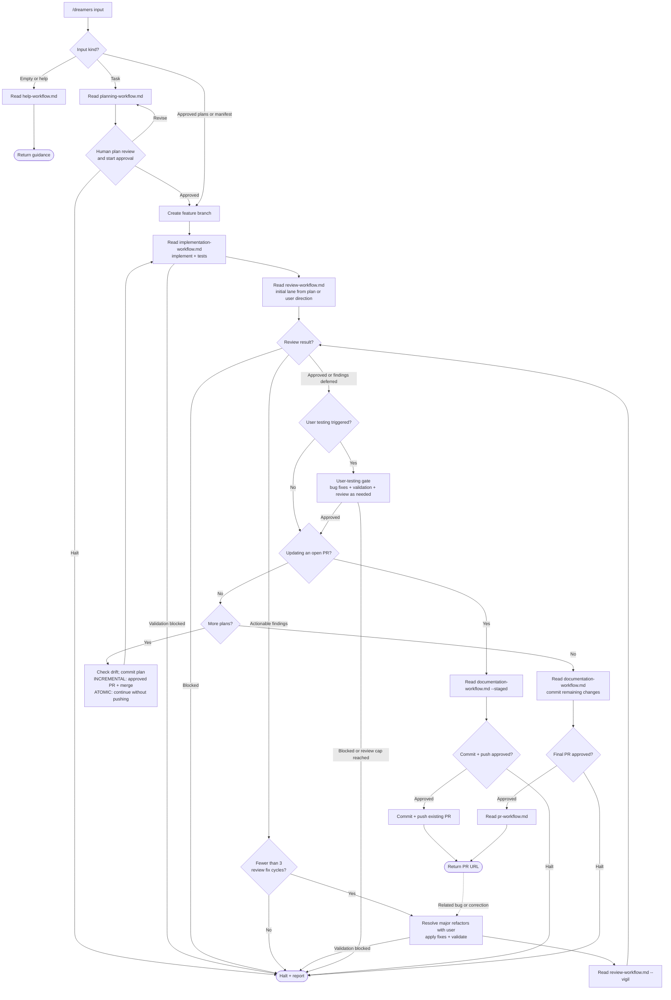

# /dreamers

Deliver tasks, approved plan paths, or a manifest. Delivery order: `SKILL.md`. Shared phase mechanics: the linked workflow refs, read directly without invoking other skills.

1. Empty/help input reads `help-workflow.md`. Task input reads `planning-workflow.md`, then human plan review and start approval. Supplied plans/manifests are already implementation authorization.
2. Implement each plan with `implementation-workflow.md`, then read `review-workflow.md`. Plan complexity selects the initial lane unless the plan or user specifies one.
3. Apply findings through at most 3 implementation/Vigil fix cycles. Ask before major refactors and record deferred findings in `defered.md`. Halt on blocked review or unresolved findings at the cap.
4. Complete triggered user testing. Between plans, check drift; ATOMIC commits and continues, while INCREMENTAL requests PR approval and waits for merge before continuing.
5. Update docs, commit remaining changes, request PR approval, and return the PR URL.

Questions leave the next phase pending; resume after answering unless the user requests discussion, pauses, or changes direction. Related bug reports authorize fixes. For an open PR, reuse its branch and repeat implementation/tests, capped Vigil review, required user testing, and docs from the uncommitted diff; ask approval before committing and pushing the update. Review caps still stop the loop.

Keep one delivery todo aligned with confirmed results, reopening affected stages after changes and reconciling stale entries after detours. New corrections after completed close-out start a new capped cycle; detours within a cycle keep its review count.

Reviewers only write review artifacts; the orchestrator applies fixes. Kernel, git workflow, and the user-testing gate are embedded through ref sync. User instructions can override workflow steps.
