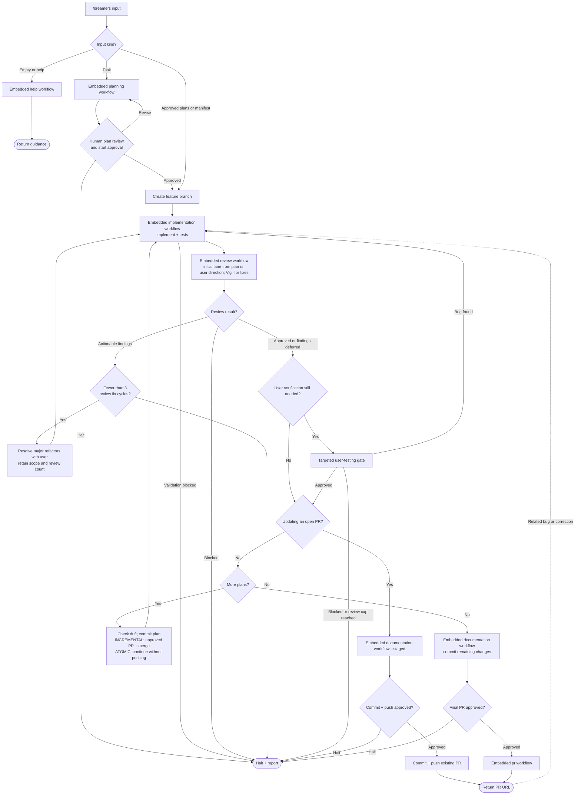

# /dreamers

Deliver tasks, approved plan paths, or a manifest. Delivery order: `SKILL.md`. Shared phase mechanics: XML-synced workflow blocks embedded in this skill, with all required standards. No skill calls or runtime ref-file reads.

The Required workflow checklist drives one todo, adding conditional stages only when applicable. Each workflow body sits inside its delivery phase: planning, implementation, review, documentation, or publishing. The skill supplies inputs and handles the returned result; shared rules and formats are grouped at the end. Operation refs contain no competing document headings or todo setup; `workflow-progress` supplies shared tracking rules. Help and user testing are embedded at their own decision points.

1. Empty/help input uses the embedded help block. Task input executes the embedded planning block, then human plan review and start approval. Supplied plans/manifests are already implementation authorization.
2. Implement each plan with `implementation-workflow.md`, then execute the embedded review block. Plan complexity selects the initial lane unless the plan or user specifies one.
3. Apply findings through at most 3 implementation/Vigil fix cycles. Ask before major refactors and record deferred findings in `defered.md`. Halt on blocked review or unresolved findings at the cap.
4. Perform available automated and agent-operated checks; request user testing only for verification the agent cannot complete or explicit personal testing. Bugs return to step 1 of Implement and review loop. Between plans, check drift; ATOMIC commits and continues, while INCREMENTAL requests PR approval and waits for merge before continuing.
5. Update docs, commit remaining changes, request PR approval, and return the PR URL.

Questions leave the next phase pending; resume after answering unless the user requests discussion, pauses, or changes direction. Related bug reports resume the existing `Implement and review loop` at step 1; do not invoke the delivery skill again. For an open PR, reuse its branch and repeat implementation/tests, capped Vigil review, required user testing, and docs from the uncommitted diff; ask approval before committing and pushing the update. Review caps still stop the loop.

Keep one delivery todo aligned with confirmed results, reopening affected stages after changes and reconciling stale entries after detours. New corrections after completed close-out start a new capped cycle; detours within a cycle keep its review count.

Reviewers only write review artifacts; the orchestrator applies fixes. All workflow and shared-standard blocks are embedded through ref sync. User instructions can override workflow steps.
