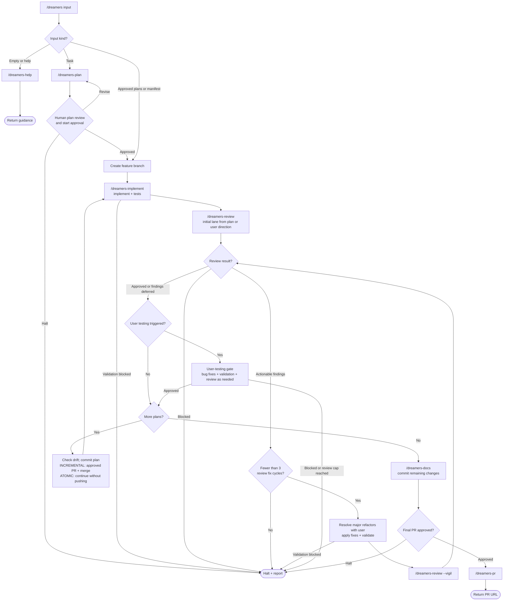

# /dreamers

Deliver tasks, approved plan paths, or a manifest. Source of truth: `SKILL.md`.

1. Empty/help input opens `/dreamers-help`. Task input invokes `/dreamers-plan`, then human plan review and start approval. Supplied plans/manifests are already implementation authorization.
2. Implement each plan with `/dreamers-implement`, then invoke `/dreamers-review`. Plan complexity selects the initial lane unless the plan or user specifies one.
3. Apply findings through at most 3 implementation/Vigil fix cycles. Ask before major refactors and record deferred findings in `defered.md`. Halt on blocked review or unresolved findings at the cap.
4. Complete triggered user testing. Between plans, check drift; ATOMIC commits and continues, while INCREMENTAL requests PR approval and waits for merge before continuing.
5. Update docs, commit remaining changes, request PR approval, and return the PR URL.

Reviewers only write review artifacts; the orchestrator applies fixes. Kernel, git workflow, and the user-testing gate are embedded through ref sync. User instructions can override workflow steps.
