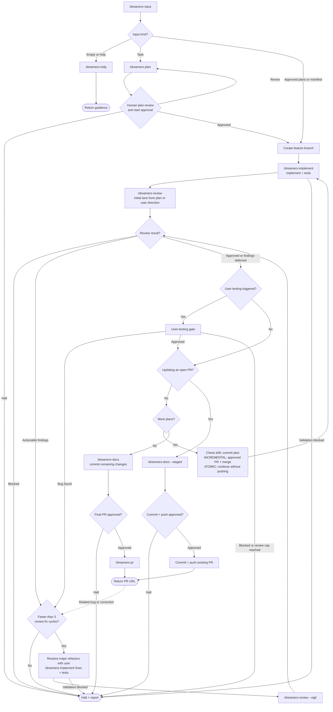

# /dreamers

Deliver tasks, approved plan paths, or a manifest. Source of truth: `SKILL.md`.

1. Empty/help input opens `/dreamers-help`. Task input invokes `/dreamers-plan`, then human plan review and start approval. Supplied plans/manifests are already implementation authorization.
2. Implement each plan with `/dreamers-implement`, then invoke `/dreamers-review`. Plan complexity selects the initial lane unless the plan or user specifies one.
3. Apply accepted findings through `/dreamers-implement`, then Vigil review, for at most 3 fix cycles. Ask before major refactors and record deferred findings in `defered.md`. Halt on blocked review or unresolved findings at the cap.
4. Complete triggered user testing. Between plans, check drift; ATOMIC commits and continues, while INCREMENTAL requests PR approval and waits for merge before continuing.
5. Update docs, commit remaining changes, request PR approval, and return the PR URL.

`/dreamers` invokes specialized phase skills only; it never invokes itself. Wrapped skills return control to the existing orchestrator without invoking their caller. Questions leave the next phase pending; resume after answering unless the user requests discussion, pauses, or changes direction.

Related bug reports during user testing or after PR creation authorize fixes through `/dreamers-implement` with the current plan/task context, followed by capped Vigil review and required user testing. For an open PR, reuse its branch, resolve archived plans when needed, and update docs from the uncommitted diff; ask approval before committing and pushing the update. Do not repeat planning/start approval or branch setup for that continuation. Review caps still stop the loop.

Keep one delivery todo aligned with confirmed results, reopening affected stages after changes and reconciling stale entries after detours. New corrections after completed close-out start a new capped cycle; detours within a cycle keep its review count.

Reviewers only write review artifacts; the orchestrator applies fixes. Kernel, git workflow, and the user-testing gate are embedded through ref sync. User instructions can override workflow steps.
